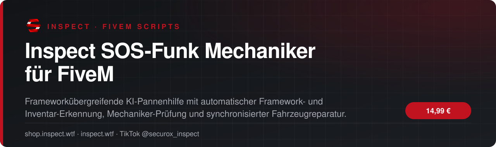

<!-- inspect-showcase: automatisch erzeugt, Änderungen bitte im Shop vornehmen -->

  
  
  
  
  

  
  
  

 

 

## Das Wichtigste auf einen Blick

<table>
  <tr>
    <td width="50%" valign="top">✔&nbsp; <b>Automatische Framework-Erkennung: ESX Legacy, QBCore und Qbox</b></td>
    <td width="50%" valign="top">✔&nbsp; <b>Automatische Inventar-Erkennung: ox_inventory, jaksam_inventory, qs-inventory, qb-inventory und Framework-Fallback</b></td>
  </tr>
  <tr>
    <td width="50%" valign="top">✔&nbsp; <b>Saubere Item-Bridge ohne doppelte Auslösung bei ox_inventory</b></td>
    <td width="50%" valign="top">✔&nbsp; <b>Jaksam-Integration über registerUsableItem, getTotalItemAmount und removeItem</b></td>
  </tr>
</table>

## Überblick

Der Inspect SOS-Funk Mechaniker erweitert deinen FiveM-Server um eine immersive KI-Pannenhilfe. Spieler verwenden ein SOS-Funkgerät und rufen einen Network-Mechaniker, wenn kein echter Mechaniker verfügbar ist. Der NPC erscheint in der Nähe, läuft zum Fahrzeug, führt eine Reparaturanimation aus und setzt das Fahrzeug zuverlässig instand. Die Resource erkennt ESX Legacy, QBCore oder Qbox automatisch und unterstützt gängige Inventarsysteme wie ox_inventory, jaksam_inventory, qs-inventory, qb-inventory sowie Framework-Fallbacks. Die bestehende Kernlogik bleibt erhalten: umgekippte Fahrzeuge können aufgerichtet, Fahrzeuge aus Wasser geborgen, Reparaturen an Spieler in der Nähe synchronisiert und zerstörte Helikopter oder Flugzeuge bei Bedarf als saubere Network-Entity ersetzt werden. Cooldowns, Kosten, Jobprüfung, Anti-Spam, Cleanup-Failsafes und optionale jg-mechanic-Unterstützung machen das System für produktive Server geeignet.

## Kompatibilität

| | |
|:--|:--|
| Frameworks | **ESX** · **QBCore** · **Qbox** |
| Unterstützte Ressourcen | `ox_inventory` |
| Plattform | FiveM (GTA V) |

## Alle weiteren Funktionen

- SOS-Funk als benutzbares Item
- KI-Mechaniker nur, wenn kein konfigurierter echter Mechaniker verfügbar ist
- QBCore/Qbox On-Duty-Prüfung unterstützt
- Network-Ped für Spieler in der Umgebung synchronisiert
- Mechaniker läuft zum Fahrzeug und spielt eine Reparaturanimation
- Unterstützt Autos, Boote, Helikopter und Flugzeuge
- Aufrichten umgekippter Fahrzeuge
- Optionales Bergen aus Wasser
- Reparatur von Motor, Karosserie, Tank, Reifen, Türen und Fahrzeugzustand
- Spezielle Behandlung zerstörter Helikopter und Flugzeuge

<b>14 weitere Funktionen anzeigen</b>

- Aircraft-Replacement mit Network-Synchronisierung
- Reparatursynchronisierung für Spieler in der Nähe
- Optionaler jg-mechanic Repair-Export
- Konfigurierbare Reparaturkosten und Geldkonto
- Konfigurierbarer Cooldown gegen Spam
- Anti-Doppelstart für laufende Einsätze
- Automatisches Cleanup des Mechaniker-NPCs
- Timeout-Failsafe für hängen gebliebene Einsätze
- Konfigurierbare Mechaniker-Jobs
- Mehrere zufällige Mechaniker-NPCs mit eigenen Sprüchen
- Keine feste es_extended-Abhängigkeit mehr im Manifest
- Zentrale config.lua für Framework, Inventar und Gameplay-Einstellungen
- Installationshinweise für SafeEvents/Anticheat enthalten
- Ausführliche Installationsanleitung für unterstützte Frameworks und Inventare

## Preis

**14,99 €** &nbsp;–&nbsp; einmaliger Kaufpreis · Download und Lizenz im Kundenkonto

Sichere Zahlung mit PayPal oder Kreditkarte · Rechnung als PDF · Support auf Deutsch

## So einfach geht's

1. **Im Shop kaufen** – sicher bezahlen mit PayPal oder Kreditkarte.
2. **Sofort loslegen** – Download und Lizenz stehen direkt nach Zahlungseingang in deinem Kundenkonto bereit, die Rechnung erhältst du als PDF.
3. **Einrichten** – bei Fragen hilft dir unser Support im Discord weiter.

## Warum INSPECT?

<table>
  <tr>
    <td width="50%" valign="top"><b>🇩🇪 Entwickelt in Deutschland</b> Konzeption, Entwicklung und Support aus einer Hand.</td>
    <td width="50%" valign="top"><b>💬 Persönlicher Support</b> Schnelle Hilfe auf Deutsch im INSPECT Discord.</td>
  </tr>
  <tr>
    <td width="50%" valign="top"><b>🔒 Sichere Zahlung</b> PayPal oder Kreditkarte, Rechnung automatisch als PDF.</td>
    <td width="50%" valign="top"><b>⚡ Sofort verfügbar</b> Download und Lizenz direkt nach der Zahlung im Kundenkonto.</td>
  </tr>
</table>

## Häufige Fragen

<b>Wie erhalte ich das Produkt?</b>

 

Nach bestätigter Zahlung stehen Download und Lizenz in deinem Kundenkonto bereit. Die Rechnung erhältst du als PDF.

<b>Welche Frameworks werden unterstützt?</b>

 

ESX, QBCore, Qbox – zusätzlich mit Unterstützung für ox_inventory.

<b>Bekomme ich Hilfe bei der Einrichtung?</b>

 

Ja – unser Support hilft dir im [INSPECT Discord](https://discord.gg/inspect) persönlich und auf Deutsch.

<b>Wo kaufe ich offiziell?</b>

 

Ausschließlich im INSPECT Shop unter [shop.inspect.wtf](https://shop.inspect.wtf). Angebote von Dritten stammen nicht von uns.

## Kontakt

| | |
|:--|:--|
| 🛒 Shop | [shop.inspect.wtf](https://shop.inspect.wtf) |
| 🌐 Website | [inspect.wtf](https://inspect.wtf) |
| 💬 Discord | [discord.gg/inspect](https://discord.gg/inspect) |
| 🎬 TikTok | [@securox_inspect](https://www.tiktok.com/@securox_inspect) |
| ✉️ E-Mail | [info@inspect.wtf](mailto:info@inspect.wtf) |

---

<b>SecuroX Inspect</b> · Offizielle Produktpräsentation · Dieses Repository enthält keinen Quellcode und keine Produktdateien. 
Kauf und Lizenzen ausschließlich über <a href="https://shop.inspect.wtf">shop.inspect.wtf</a> · Inhalte werden automatisch aus dem Shop aktualisiert.

